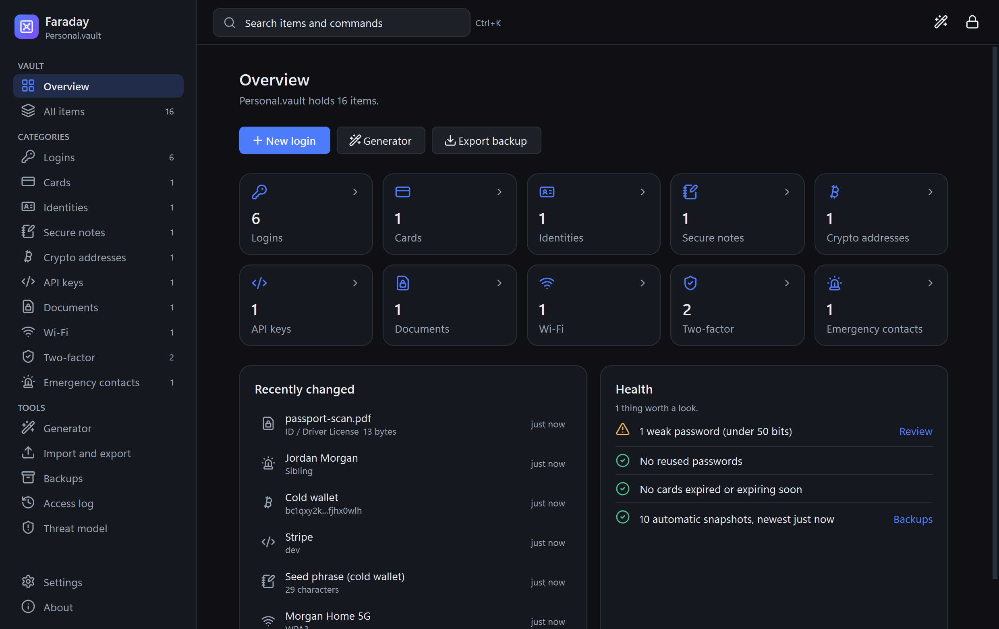
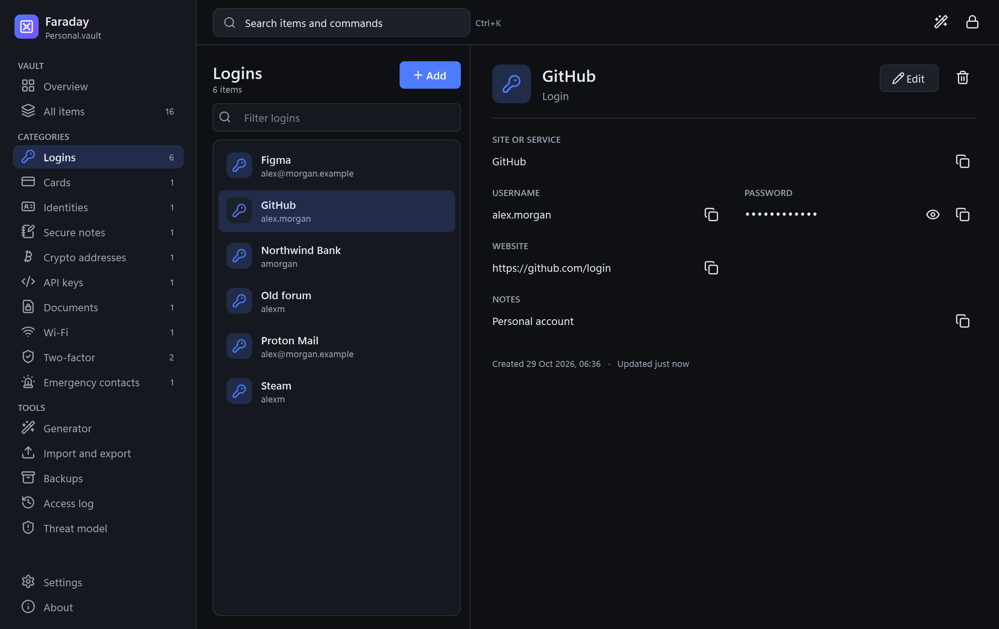
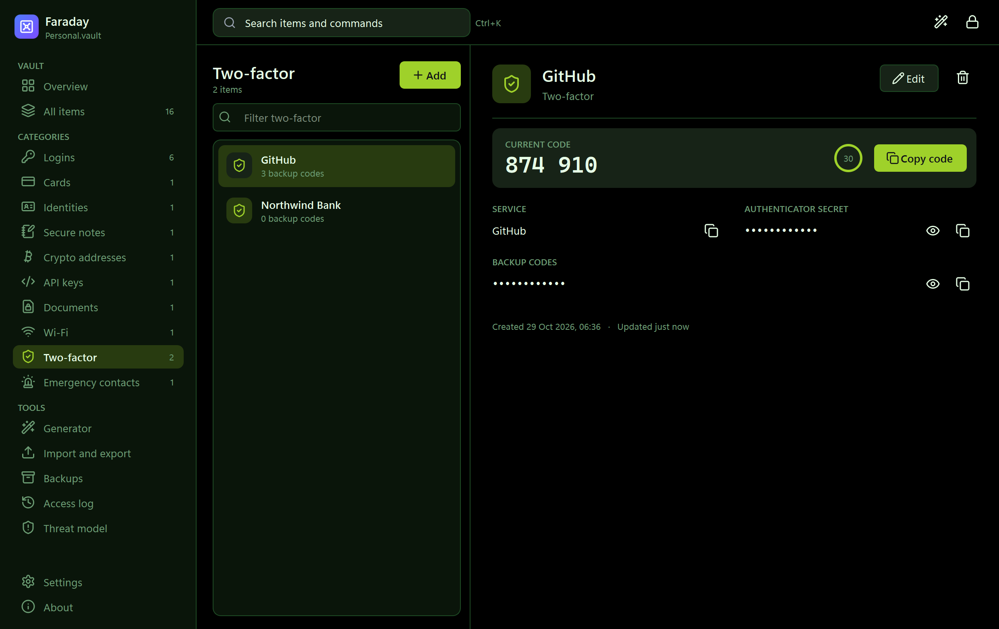
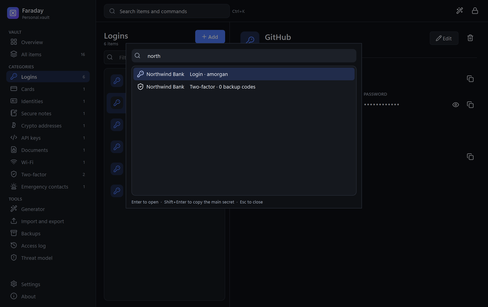
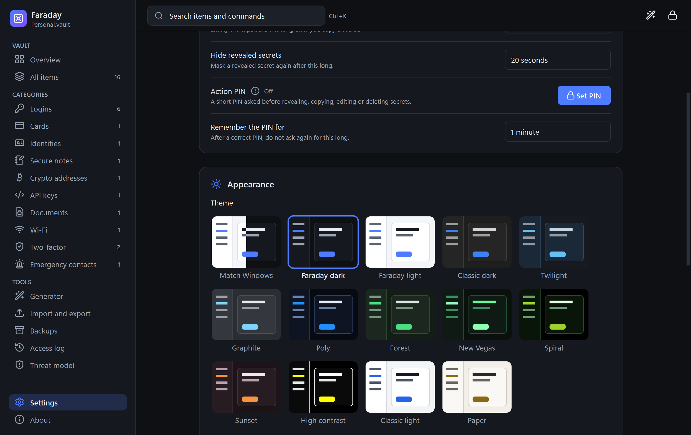
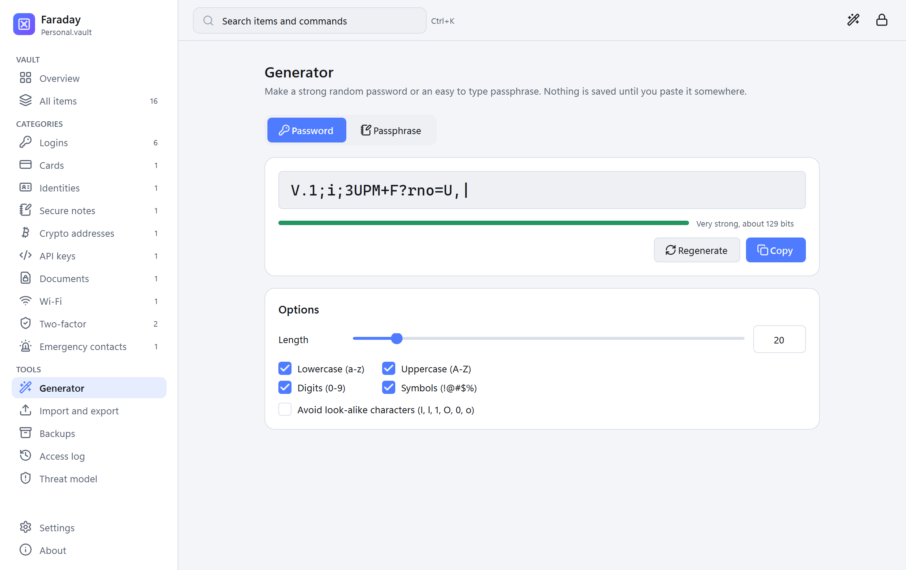
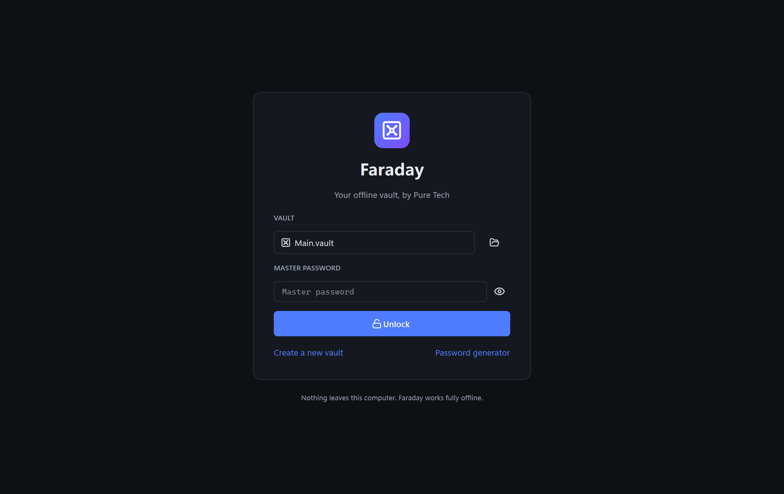

# Project Faraday


Copyright © 2026 Pure Tech

Project Faraday is a secure, offline-first credential and digital-asset vault developed and maintained by Pure Tech. It provides both a command-line interface and a native graphical application for storing passwords, cryptographic keys, and sensitive records with provably strong, locally executed cryptography.



## Screenshots

| | |
|---|---|
|  |  |
| **Every item, every field.** Copy any field; secrets stay masked until you reveal them. | **Live two-factor codes** with a countdown, shown here in the Spiral theme. |
|  |  |
| **Ctrl+K** jumps to any item or command. | **14 themes**, including all the classics from 3.0. |
|  |  |
| **Generator** for passwords and passphrases, even while locked. | **Lock screen.** Auto-locks when idle or when Windows locks. |

Screenshots use a demo vault with made-up data (`python scripts/make_screenshots.py` regenerates them).

## Overview

Project Faraday is an enterprise-grade secrets-management solution engineered around a single principle: **your data never leaves your machine**. All key derivation and encryption operations are performed locally. There are no cloud services, no network calls, and no telemetry. Vaults are stored as encrypted files that remain entirely under the owner's control and can be backed up or transferred at will.

The product targets individuals and teams who require verifiable data sovereignty without the lock-in, recurring cost, or trust assumptions of hosted password managers.

## Why Project Faraday?

Most mainstream password managers are cloud-centric and subscription-based, which introduces connectivity requirements, third-party trust, and ongoing cost for what is fundamentally a security-critical tool. Project Faraday addresses this gap with a self-contained vault that runs completely offline.

**Problems we solve:**

- Eliminates dependence on cloud infrastructure and third-party trust for credential storage
- Removes recurring subscription cost from essential security tooling
- Avoids privacy exposure inherent in remotely stored encrypted data
- Operates reliably in air-gapped or connectivity-constrained environments
- Returns full ownership and portability of encrypted data to the user

**Our approach:**

Project Faraday delivers a professionally engineered secrets-management system that runs entirely on the local device. Whether storing cryptocurrency wallets, banking credentials, API keys, or personal identity records, data is encrypted at rest and never transmitted. The resulting vault file is portable, backup-friendly, and free of accounts, subscriptions, or external dependencies.

**Ideal for:**

- **Privacy-conscious users** who require complete data sovereignty
- **Offline-first and regulated workflows** where connectivity cannot be assumed
- **Cryptocurrency holders** who need secure storage for wallets and recovery phrases
- **Engineering and security teams** standardizing on vendor-neutral tooling

## About Pure Tech

Pure Tech is a software company focused on privacy-respecting, security-first tooling. Project Faraday is built and supported as a maintained product: it follows a documented cryptographic specification, a versioned vault format, and an established threat model. Development prioritizes cryptographic correctness, secure file handling, and a clean, accessible user experience over convenience-driven shortcuts.

## Table of Contents

- [Screenshots](#screenshots)
- [Why Project Faraday?](#why-project-faraday)
- [Features](#features)
- [Security Architecture](#security-architecture)
  - [Threat Model](#threat-model)
- [Installation](#installation)
  - [Prerequisites](#prerequisites)
  - [Installation Steps](#installation-steps)
  - [Windows app](#windows-app)
- [Usage](#usage)
  - [Command Line Interface (CLI)](#command-line-interface-cli)
  - [Graphical User Interface (GUI)](#graphical-user-interface-gui)
- [Detailed Examples](#detailed-examples)
- [Vault Format](#vault-format)
- [File Locations](#file-locations)
- [Backups](#backups)
- [Security Best Practices](#security-best-practices)
- [Troubleshooting](#troubleshooting)
- [Development](#development)
- [License](#license)
- [Contributing](#contributing)
- [Disclaimer](#disclaimer)
- [Additional Documentation](#additional-documentation)
- [Support](#support)

## Features

- **Offline-First Architecture**: Complete local operation with zero network dependencies
- **Multi-Vault Support**: Create and manage multiple independent vaults with separate encryption keys
- **Broad Record Support**: Store credentials, notes, cards, identities, 2FA data, Wi-Fi records, documents, API keys, emergency contacts, and crypto addresses
- **Dual Entry Types**: Store cryptocurrency addresses and username/password credentials
- **Action PIN Guard (Optional)**: Add an extra unlock step for sensitive actions
- **Threat Model Panel**: In-app educational tab with local Argon2 timing and metadata-only analysis
- **Advanced Password Generator**: Cryptographically secure generation with customizable character sets and exclusion rules
- **Dual Interface**: Full-featured CLI for automation and GUI for interactive use
- **Modern Desktop App**: PySide6 (Qt) GUI with light and dark themes, a command palette (Ctrl+K) and keyboard shortcuts
- **Live Two-Factor Codes**: Authenticator codes for stored TOTP secrets
- **Import and Encrypted Export**: Bitwarden, KeePass and KeePassXC imports; password-protected `.faraday` archives
- **Recent Vaults Management**: The GUI remembers recently opened vaults
- **System Tray Integration**: Tray icon with lock, generator and exit
- **Automatic Locking**: Locks after a configurable idle time, when Windows locks or sleeps, and optionally on minimize
- **Automatic Snapshots**: An encrypted copy of the previous version is kept before every save
- **Crash-Safe Saves**: Atomic writes, file locking between windows and the CLI, and rollback on failure
- **Enterprise-Grade Cryptography**: Argon2id key derivation with configurable security levels and AES-256-GCM authenticated encryption
- **Secure File Operations**: Restrictive file permissions and secure deletion capabilities

## Security Architecture

Project Faraday implements industry-standard cryptographic primitives:

- **Argon2id Key Derivation**: Configurable security levels (standard, high, maximum) with memory-hard parameters
- **AES-256-GCM Encryption**: Authenticated encryption with unique nonces per operation
- **CBOR Serialization**: Binary format prevents accidental plaintext exposure
- **Secure File Permissions**: Restrictive access controls (0o600 on Unix, user-only on Windows)
- **Secure Deletion**: Multi-pass overwrite for temporary files and optional secure vault deletion

### Threat Model

**Protected Against:**

- Physical disk theft and offline attacks
- Brute-force password attacks (computationally infeasible with standard+ security levels)
- Unauthorized file access through restrictive permissions
- Temporary file recovery through secure deletion

**Not Protected Against:**

- Compromised operating systems or malware
- Keyloggers and screen capture software
- Live memory analysis attacks
- Social engineering attacks

**Important**: See [SECURITY.md](SECURITY.md) for comprehensive security documentation, threat model analysis, and best practices.

## Installation

### Prerequisites

- Windows 10/11 (Linux and macOS also work)
- Python 3.10 or later
- pip

### Installation Steps

1. **Clone or download this repository**

2. **Install the package** (creates the `faraday` command):

   ```bash
   pip install -e .
   ```

   This installs Project Faraday and exposes a `faraday` command available from any working directory.

3. **Verify installation**:

   ```bash
   faraday --help
   ```

### Windows app

Build a standalone `Faraday.exe` (no Python needed to run it) and install it for your user:

```powershell
powershell -ExecutionPolicy Bypass -File packaging\build.ps1
powershell -ExecutionPolicy Bypass -File packaging\install.ps1
```

The app goes to `%LOCALAPPDATA%\Programs\Faraday` with a Start Menu shortcut (add `-DesktopShortcut`
for one on the desktop). Run `uninstall.ps1` in that folder to remove it. Installing, upgrading and
uninstalling never touch your vaults or settings.

### Optional: Check Dependencies

Run `dependencies.bat` (Windows) to check what is installed (informational only).

## Usage

### Command Line Interface (CLI)

#### Basic Commands

**Create a new vault:**

```bash
faraday init
```

This creates `Documents\Faraday\faraday.vault` by default.

**Create a vault with a custom name:**

```bash
faraday --vault my_vault.vault init
```

Or use a relative path from the vaults directory:

```bash
faraday --vault my_vault.vault init
```

**Unlock a vault:**

```bash
faraday unlock
```

**Add a crypto address:**

```bash
faraday add-crypto "1A1zP1eP5QGefi2DMPTfTL5SLmv7DivfNa" --note "Bitcoin main wallet"
```

**Add credentials:**

```bash
faraday add-credential "username" "password" --note "My bank account"
```

**List all entries:**

```bash
faraday list
```

**List only crypto entries:**

```bash
faraday list --type crypto
```

**List only credential entries:**

```bash
faraday list --type credential
```

**Get entry details by ID:**

```bash
faraday get <entry-id>
```

**Generate a password:**

```bash
faraday generate --length 20
```

**Generate a password with custom rules:**

```bash
faraday generate --length 24 --no-symbols --exclude "0O1l"
```

#### List Available Vaults

**List all vault files in the vaults directory:**

```bash
faraday --vaultlist
```

This shows all `.vault` files in `Documents\Faraday` with their paths and sizes, making it easy to see what vaults are available.

#### Multiple Vaults

You can create and use multiple vaults by specifying different paths:

```bash
# List available vaults
faraday --vaultlist

# Create work vault (in Documents\Faraday)
faraday --vault work.vault init

# Create personal vault (in Documents\Faraday)
faraday --vault personal.vault init

# Use work vault
faraday --vault work.vault add-credential user pass --note "Work account"

# Use personal vault
faraday --vault personal.vault list
```

Each vault is completely independent with its own password and encryption.

### Graphical User Interface (GUI)

**Launch the GUI:**

```bash
faraday gui
```

After `pip install -e .` there is also a `faraday-gui` launcher that starts without a console window.
To install Faraday as a normal Windows app with a Start Menu shortcut, see [Windows app](#windows-app).

#### GUI Features

- **Lock screen**: pick a recent vault (or browse for one), enter the master password, or create a new vault.
  Key derivation runs in the background, so the window never freezes.
- **Sidebar**: Overview, All items, the ten entry types with counts, and tools (Generator, Backups,
  Access log, Threat model), plus Settings and About.
- **Entries**: a filterable list and a detail pane for every type. Every field has a copy button; secrets
  stay masked until you reveal them and mask themselves again after a short delay.
- **Editing**: forms with inline validation. Saving an edit keeps the entry's id and created date.
- **Documents**: files are encrypted into the vault and can be exported again (integrity-checked).
- **Command palette (Ctrl+K)**: jump to any item or command. Shift+Enter copies the item's main secret.
- **Generator**: random passwords (8 to 128 characters) or passphrases (3 to 12 words), also available
  from the lock screen.
- **Overview**: counts plus health checks (weak or reused passwords, expiring cards, snapshot age).
- **Backups**: restore an automatic snapshot, or export a verified full backup including attachments.
- **Themes**: 13 themes (the 11 classic ones from 3.0 such as Spiral, New Vegas and Paper, plus Faraday dark
  and light) or Match Windows, picked from a preview gallery in Settings. Any theme can take a custom accent colour.
- **Settings**: auto-lock, clipboard clear and reveal delays, action PIN, theme and accent colour,
  text size, tray behaviour, lock when Windows locks, and hiding the window from screen capture.
- **Two-factor codes**: two-factor items with an authenticator secret (base32 or an `otpauth://` link)
  show the live 6 to 8 digit code with a countdown, like an authenticator app. Ctrl+Shift+C copies it.
- **Import and export**: import from Bitwarden (.json, .csv), KeePass 2 (.xml, .csv), KeePassXC (.csv),
  another Faraday vault or a `.faraday` archive, with a preview and duplicate detection. After importing a
  plain-text export Faraday offers to securely delete it. Export writes one password-protected `.faraday`
  archive with every item and document; there is no plain-text export.
- **Clipboard**: copied secrets are cleared after a delay (only if they are still on the clipboard) and are
  kept out of Windows clipboard history and cloud clipboard.

#### Keyboard shortcuts

| Shortcut | Action |
|---|---|
| Ctrl+K | Search items and commands |
| Ctrl+N | New item of the current type |
| F2 | Edit the selected item |
| Delete | Delete the selected item (when the list has focus) |
| Ctrl+Shift+C | Copy the selected item's main secret |
| Ctrl+F | Filter the current list |
| Ctrl+G | Password generator |
| Ctrl+, | Settings |
| Ctrl+L | Lock now |

#### Action PIN

An optional PIN guards revealing and copying secrets, editing, deleting and exporting documents.
After a correct PIN, Faraday trusts the session for a grace period (default 60 seconds).
After 5 wrong PINs only the master password is accepted until the next unlock. Restoring a backup,
clearing the access log, changing the PIN or turning auto-lock off always ask for the master password.

## Detailed Examples

### Creating and Using Multiple Vaults

```bash
# Create a vault for work (in Documents\Faraday)
faraday --vault work.vault init
# Enter password when prompted

# Create a vault for personal use (in Documents\Faraday)
faraday --vault personal.vault init
# Enter different password when prompted

# Add entries to work vault
faraday --vault work.vault add-credential workuser workpass --note "Work email"
faraday --vault work.vault add-crypto "0x742d35Cc6634C0532925a3b844Bc9e7595f0bEb" --note "Work crypto wallet"

# Add entries to personal vault
faraday --vault personal.vault add-credential personaluser personalpass --note "Personal email"
faraday --vault personal.vault list
```

### Password Generation

```bash
# Generate a 16-character password (default)
faraday generate

# Generate a 32-character password
faraday generate --length 32

# Generate password without symbols
faraday generate --length 20 --no-symbols

# Generate password with only letters and numbers
faraday generate --length 16 --no-symbols

# Generate password excluding confusing characters
faraday generate --length 20 --exclude "0O1lI|"
```

### Working with Entries

```bash
# List all entries
faraday list

# List only crypto addresses
faraday list --type crypto

# List only credentials
faraday list --type credential

# Get full details of a specific entry
faraday get <entry-id-from-list>

# Add entry with note
faraday add-credential "john@example.com" "mypassword123" --note "Email account"
faraday add-crypto "bc1qxy2kgdygjrsqtzq2n0yrf2493p83kkfjhx0wlh" --note "Bitcoin wallet"
```

## Vault Format

Vault files are encrypted and stored locally. The format is versioned; see the [vault file format](docs/vault-format.md) for technical details. New versions will not silently modify existing vaults.

**Important**: Always back up your vault file. Loss of the vault file results in total loss of the stored data. Because the file is encrypted, it is safe to back up to external storage.

## File Locations

- **Vault files**: `Documents\Faraday` (or any path you choose). Set `FARADAY_VAULTS_DIR` to use a
  different default folder. Keep vaults out of source folders so tools like `git clean` can never touch them.
- **Automatic snapshots**: `<vault>.backups/` next to each vault
- **Attachments**: `<vault>.attachments/` next to each vault (encrypted)
- **Settings, recent vaults, action PIN, access log**: `%LOCALAPPDATA%\FaradayVault\` on Windows
  (`~/.config/FaradayVault/` elsewhere). Set `FARADAY_APPDATA` to use a different folder.
- **Default CLI vault**: `Documents\Faraday\faraday.vault` (if no `--vault` flag is used; a bare
  `--vault name.vault` also means a file in that folder)

## Backups

- Before every save, Faraday keeps the previous encrypted version in `<vault>.backups/`
  (the 10 newest, plus one per day for 14 days; configurable in Settings).
  Restore one from the Backups page or with `faraday list-backups` and `faraday restore <number>`.
- For a complete copy including document attachments, use **Export full backup** on the Backups page,
  or `faraday backup <folder>`. Every copied file is verified.
- Keep at least one copy somewhere other than this PC.

## Security Best Practices

1. **Use strong master passwords**: Your vault is only as secure as your master password
2. **Back up your vault file**: Store encrypted vault files in multiple safe locations
3. **Lock when not in use**: The GUI auto-locks after a configurable idle time and when Windows locks; Ctrl+L locks immediately
4. **Use different vaults**: Separate work and personal data into different vaults
5. **Keep your system secure**: Project Faraday cannot protect against compromised systems
6. **Read SECURITY.md**: Understand the threat model and limitations

## Troubleshooting

### "Vault file already exists" error

If you try to create a vault that already exists:

- Use a different name: `faraday --vault new_name.vault init`
- Or use the existing vault: `faraday unlock`

### "ModuleNotFoundError: No module named 'faraday'"

Make sure you installed the package:

```bash
pip install -e .
```

### GUI won't start

- Make sure PySide6 is installed: `pip install -e .` installs it

### "This vault is open in another Faraday window"

Only one Faraday window or CLI command can have a vault open for writing. Lock or close the other one.
If Faraday crashed, the lock is released automatically.

### "The vault file was changed by another program"

Faraday refuses to overwrite a vault that changed on disk after it was opened (for example by a sync
tool). Lock and unlock again to load the current file. Nothing was lost; earlier versions are in `<vault>.backups/`.

### Can't unlock vault

- Make sure you're using the correct password
- Make sure you're pointing to the correct vault file with `--vault` if needed
- Check that the vault file exists and isn't corrupted

## Development

### Project Structure

```
faraday/
|-- __main__.py          # Entry point (CLI and `gui`)
|-- cli.py               # Command-line interface
|-- paths.py, settings.py, recent.py, pin.py, threat_model.py, access_log.py, totp.py
|-- generator/           # Password and passphrase generator (+ EFF wordlist)
|-- models/              # Entry models and schema.py (field specs for every type)
|-- vault/               # Core: manager, crypto, atomic writes, file lock, backups
|-- transfer/            # Importers (Bitwarden, KeePass) and encrypted .faraday archives
|-- qt/                  # PySide6 desktop app
|   |-- app.py, main_window.py, context.py, theme.py, icons.py
|   |-- services/        # VaultService, clipboard, idle lock, PIN guard, workers
|   |-- views/           # unlock, shell, entries, palette and the tool pages
|   `-- widgets/         # shared widgets and dialogs
packaging/               # PyInstaller spec, icon, build and install scripts
tests/                   # pytest suite (core and offscreen GUI tests)
```

### Running from Source

```bash
# Install in development mode
pip install -e .

# Run CLI
python -m faraday list

# Run GUI
python -m faraday gui

# Run the tests
pip install -r requirements-dev.txt
python -m pytest
```

Tests never touch real vaults; a guard in `tests/conftest.py` fails any test that reaches `Documents\Faraday`.
For manual runs against a throwaway vault, point `FARADAY_VAULTS_DIR` and `FARADAY_APPDATA` at a scratch folder.

## License

Copyright © 2026 Pure Tech

This project is licensed under the MIT License. See [LICENSE.txt](LICENSE.txt) for the full text.

## Contributing

Contributions are welcome. This project adheres to strict security and design principles:

- **Offline-First**: No network features, telemetry, or external dependencies
- **Security-First Design**: Cryptographic correctness takes precedence over convenience
- **Documentation**: See the [docs folder](docs/README.md)
- **Comprehensive Testing**: All changes, especially security-related, must be thoroughly tested

## Disclaimer

This software is provided "as-is" without warranty of any kind. Users are responsible for maintaining backups of their vault files and protecting their master passwords. The developers assume no liability for data loss or security incidents.

## Additional Documentation

- [SECURITY.md](SECURITY.md): security model, threat model and data safety
- [CHANGELOG.md](CHANGELOG.md): release history
- [Vault file format](docs/vault-format.md): technical specification of vaults and `.faraday` archives
- [Credits](docs/credits.md): third-party icons and wordlist
- [All documentation](docs/README.md)

## Support

For bug reports, feature requests, security issues, or contributions, please use the project's issue tracker or submit a pull request. Security vulnerabilities should be reported privately.

---

**Note**: Your vault is encrypted with AES-256-GCM and Argon2id. If you lose your master password, the data is cryptographically unrecoverable: there is no backdoor by design. Maintain secure backups and safeguard your master password.
